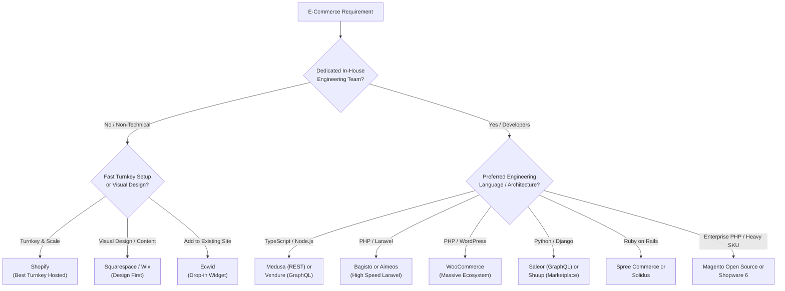

# 🛒 Awesome Online Storefront & Shopping Cart 🛍️

  

  
  
  
  
  
  
  

> 🌟 **Awesome Online Storefront & Shopping Cart** is a comprehensive, SEO-optimized, curated guide and comparative directory of modern e-commerce storefronts, cloud-hosted SaaS platforms, headless API engines, and self-hosted open-source shopping cart frameworks.
>
> 🚀 **Star this repository if you find it helpful for your e-commerce stack decisions!** 🌟

---

## 📑 Table of Contents 🧭

- [📈 Sector Overview & Market Dynamics](#-sector-overview--market-dynamics)
- [🟦 SaaS / Hosted Platforms](#-saas--hosted-platforms)
  - [🏢 Commercial Platform Comparison](#-commercial-platform-comparison)
  - [🔍 Platform Profiles](#-platform-profiles)
- [🟩 Open-Source Software](#-open-source-software)
  - [⭐ Open-Source Ecosystem Ranked by Stars](#-open-source-ecosystem-ranked-by-stars)
  - [🛠️ Framework Profiles](#️-framework-profiles)
- [📊 Technical Architecture Comparison](#-technical-architecture-comparison)
- [🎯 Selection Guide & Decision Matrix](#-selection-guide--decision-matrix)
- [🌟 Star History](#-star-history)
- [💖 Support & Sponsorship](#-support--sponsorship)
- [🤝 Contributing](#-contributing)
- [📄 License](#-license)

---

## 📈 Sector Overview & Market Dynamics 🌐

The global **e-commerce platforms and shopping cart software market** represents an estimated valuation of **$8.2 billion to $10.5 billion (with broader digital commerce infrastructure exceeding $27 billion)**, expanding at a compound annual growth rate (**CAGR**) of approximately **12.5% to 14.8%** toward a projected $20+ billion by the early 2030s.

The sector is **moderately fragmented yet tiered into distinct sub-ecosystems**: while enterprise-hosted SaaS exhibits winner-takes-most consolidation led by giants like Shopify, the broader market remains fragmented across specialized verticals, headless/composable API platforms, regional mid-market providers, and a vibrant self-hosted open-source community that retains substantial global checkout volume (such as WooCommerce powering over a third of transactional storefronts worldwide).

---

## 🟦 SaaS / Hosted Platforms ☁️

Commercial, turnkey, and cloud-hosted online storefront solutions providing automated infrastructure, native payment processing, CDN distribution, and managed compliance.

### 🏢 Commercial Platform Comparison 🏷️

The table below is sorted in descending order by **Company Size (Revenue / Market Capitalization / Valuation)**.

| 🏬 Platform | 💰 Company Size (Valuation / Market Cap / ARR) | 💳 Starting Tier Pricing | 🎁 Free Tier Limit / Trial Duration | 🎯 Primary Focus & Checkout Architecture |
|:---|:---:|:---|:---|:---|
| **[Shopify](https://www.shopify.com/)** | **~$210.0B Market Cap** | **$39/month** (Basic monthly, or $29/mo billed annually) + 2.9% + 30¢ per txn | **3-day free trial** (No credit card needed) + 3 months promotional trial at $1/month; no permanent free plan | All-in-one hosted commerce, global POS, multi-channel selling, checkout extensibility |
| **[Wix eCommerce](https://www.wix.com/ecommerce)** | **~$5.8B Market Cap** | **$29/month** (Core plan, billed annually) + 2.9% + 30¢ per txn | **Free forever plan available** (restricted to 500 MB storage, 1 GB bandwidth, Wix-branded subdomain; **cannot accept online payments or checkout**); 14-day refund policy | Drag-and-drop website builder with integrated shopping cart and digital storefront |
| **[Squarespace Commerce](https://www.squarespace.com/ecommerce-website)** | **~$7.2B Valuation** *(Acquired by Permira in 2024)* | **$25/month** ($19/mo billed annually) with 2% txn fee; or **$39/month** ($29/mo billed annually) for Core plan with 0% txn fee | **14-day free trial** (Full design & cart configuration access; credit card not required; live transactions and custom domains disabled until upgrade; 7-day trial extension available upon request) | Design-centric storefront creation, portfolio commerce, and content-rich boutiques |
| **[Shift4Shop](https://www.shift4shop.com/)** | **~$4.3B Market Cap** *(Shift4 Payments)* | **$0/month platform fee** (Enterprise plan when processing ≥$500/mo via Shift4 Payments); alternatively **$29/month** for standalone standard paid tier | **$0/month free tier** (Requires US merchant account and exclusive use of Shift4 Payments processing min. $500/month; includes unlimited products, bandwidth, staff accounts, and zero monthly subscription fee) | Turnkey hosted commerce powered by embedded payment processing services |
| **[Ecwid by Lightspeed](https://www.ecwid.com/)** | **~$1.65B Market Cap** *(Lightspeed Commerce)* | **$19/month** (Venture plan billed annually at $15/mo, or $19 monthly) for up to 100 products | **Free forever plan available** (Limited to 5 physical products maximum, 1 payment gateway, standard storefront embed; no digital products, no abandoned cart recovery, no social marketplace selling) | Embeddable shopping cart widget, headless buy buttons for existing CMS sites |
| **[BigCommerce](https://www.bigcommerce.com/)** | **~$380M Market Cap** *(Commerce.com, Inc.)* | **$39/month** (Standard plan monthly, or $29/mo billed annually) with 0% transaction fees | **15-day free trial** (Full platform functionality and sandbox checkout setup; no credit card required; $50,000 GMV annual sales cap on standard tier) | Enterprise headless commerce, native multi-storefront B2B/B2C, extensive REST/GraphQL APIs |
| **[Snipcart](https://snipcart.com/)** | **~$1.2M ARR** *(Acquired by Duda)* | **2% per transaction** (with a **$20/month minimum invoice** if monthly store sales fall below $1,000) | **Forever-free test & development environment** (Unlimited products, API keys, test webhooks, and sandbox payments; $0 cost until switching domain to live mode) | Developer-centric HTML/JavaScript drop-in shopping cart for Jamstack & static sites |

### 🔍 Platform Profiles 📝

#### 🛍️ Shopify
- **Overview:** The market leader in hosted e-commerce, offering turnkey storefront building, managed hosting, integrated merchant processing (Shopify Payments), and a directory of over 8,000 apps.
- **Strengths:** Unrivaled checkout conversion (Shop Pay), massive ecosystem, and enterprise scale via Shopify Plus.
- **Considerations:** Additional transaction fees when using third-party payment gateways; liquid template lock-in unless using headless Hydrogen/Oxygen.

#### 🎨 Wix eCommerce
- **Overview:** Integrates full e-commerce capabilities into Wix's visual website builder, targeting small-to-medium businesses wanting rapid page design.
- **Strengths:** Visual canvas, rich theme library, integrated marketing suites, and built-in appointment/booking capabilities.
- **Considerations:** Limited multi-currency and complex inventory controls compared to dedicated commerce backends.

#### 📐 Squarespace Commerce
- **Overview:** Combines award-winning design templates with native digital product, subscription, and physical goods fulfillment.
- **Strengths:** Polished aesthetic presentation, fluid content-commerce integration, native blogging, and scheduling integrations.
- **Considerations:** Basic tiers include a 2% platform transaction surcharge; fewer third-party deep logistical integrations.

#### 💳 Shift4Shop
- **Overview:** Formerly 3dcart, offering an enterprise-grade hosted storefront completely free of monthly software licensing fees when utilizing Shift4 payment processing.
- **Strengths:** Unlimited products, no monthly software fee for eligible US merchants, built-in fraud prevention.
- **Considerations:** Restricted availability for international merchants and businesses unable to utilize Shift4 merchant acquiring.

#### 🔌 Ecwid by Lightspeed
- **Overview:** A lightweight, embeddable widget cart designed to turn any existing static website, WordPress blog, or social profile into a transactional storefront.
- **Strengths:** Quick setup without replatforming existing sites; centralized inventory synchronization across multiple sites.
- **Considerations:** Deep storefront customization is restricted by iframe/script containment models.

#### 🚀 BigCommerce
- **Overview:** A robust cloud platform emphasizing headless agility, zero native platform transaction penalties, and native B2B wholesale portals.
- **Strengths:** Native multi-storefront, open API architecture, advanced faceted product filtering, and multi-currency support.
- **Considerations:** Automatic tier forced upgrades when annual GMV exceeds plan thresholds (e.g., $50,000 GMV limit on Standard).

#### 💻 Snipcart
- **Overview:** A developer-first shopping cart platform injected via a couple of lines of HTML and JavaScript into Jamstack, Astro, Next.js, or static Hugo/Jekyll websites.
- **Strengths:** Complete styling autonomy, decoupled architecture, simple webhook and JSON payload management.
- **Considerations:** Requires HTML/JS developer proficiency; $20 monthly minimum floor regardless of low volume.

---

## 🟩 Open-Source Software 🔓

Self-hosted, modular, and developer-owned e-commerce engines offering full source code transparency, zero vendor lock-in, database ownership, and zero revenue-sharing transaction fees.

### ⭐ Open-Source Ecosystem Ranked by GitHub_Stars 🏆

The open-source repository list below is sorted in descending order by **GitHub Stargazers Count** (verified directly via GitHub API). Each Stars_Badge links directly to the stargazers page of that repository.

| 📦 Software | ⭐ GitHub_Stars | 💻 Core Tech Stack | 🏗️ Primary Architecture | ⚖️ License | 🔗 Stargazers Link |
|:---|:---:|:---|:---|:---:|:---:|
| **[Medusa](#medusa)** |  | TypeScript / Node.js / PostgreSQL | Headless / Composable / REST API | MIT | [Stargazers](https://github.com/medusajs/medusa/stargazers) |
| **[Bagisto](#bagisto)** |  | PHP / Laravel / Vue.js | Monolith + Headless REST & GraphQL | MIT | [Stargazers](https://github.com/bagisto/bagisto/stargazers) |
| **[Saleor](#saleor)** |  | Python / Django / PostgreSQL | Headless / GraphQL API | BSD-3-Clause | [Stargazers](https://github.com/saleor/saleor/stargazers) |
| **[Spree Commerce](#spree-commerce)** |  | Ruby on Rails / Turbo / PostgreSQL | Modular Headless / REST API | BSD-3-Clause | [Stargazers](https://github.com/spree/spree/stargazers) |
| **[Reaction Commerce](#reaction-commerce)** |  | Node.js / GraphQL / MongoDB / Docker | Headless / Microservices / Event-Driven | GPL-3.0 | [Stargazers](https://github.com/reactioncommerce/reaction/stargazers) |
| **[Magento Open Source](#magento-open-source)** |  | PHP / MySQL / Elasticsearch | Enterprise Monolith / REST & GraphQL | OSL-3.0 | [Stargazers](https://github.com/magento/magento2/stargazers) |
| **[WooCommerce](#woocommerce)** |  | PHP / WordPress / MySQL | CMS-Integrated Plugin / REST API | GPL-3.0 | [Stargazers](https://github.com/woocommerce/woocommerce/stargazers) |
| **[PrestaShop](#prestashop)** |  | PHP / Symfony / MySQL | Monolith + Module Ecosystem | OSL-3.0 | [Stargazers](https://github.com/PrestaShop/PrestaShop/stargazers) |
| **[Aimeos](#aimeos)** |  | PHP / Laravel / Multi-DB | Ultra-Fast Framework / JSON REST & GraphQL | LGPL-3.0 | [Stargazers](https://github.com/aimeos/aimeos-laravel/stargazers) |
| **[Vendure](#vendure)** |  | TypeScript / NestJS / GraphQL | Headless / Modern Micro-framework | MIT | [Stargazers](https://github.com/vendure-ecommerce/vendure/stargazers) |
| **[Sylius](#sylius)** |  | PHP / Symfony / API Platform | Tailored B2B/B2C / Unified REST | MIT | [Stargazers](https://github.com/Sylius/Sylius/stargazers) |
| **[OpenCart](#opencart)** |  | PHP / MySQL | Lightweight MVC Monolith | GPL-3.0 | [Stargazers](https://github.com/opencart/opencart/stargazers) |
| **[Solidus](#solidus)** |  | Ruby on Rails / PostgreSQL | High-Volume Customizable Engine | BSD-3-Clause | [Stargazers](https://github.com/solidusio/solidus/stargazers) |
| **[Shopware 6](#shopware-6)** |  | PHP / Symfony / Vue.js | API-First Headless + Admin Monolith | MIT | [Stargazers](https://github.com/shopware/shopware/stargazers) |
| **[Shuup](#shuup)** |  | Python / Django / PostgreSQL | Multi-Vendor Marketplace & B2B | OSL-3.0 | [Stargazers](https://github.com/shuup/shuup/stargazers) |

---

### 🛠️ Framework Profiles 📌

#### 🐙 Medusa
- **Repository:** [medusajs/medusa](https://github.com/medusajs/medusa) | 
- **Tech Stack:** TypeScript, Node.js, PostgreSQL, Redis
- **License:** MIT
- **Overview:** Known as the "open-source alternative to Shopify," Medusa delivers composable commerce modules (products, carts, orders, pricing, taxes, inventory) exposed through high-performance REST APIs and an open-source React administration panel.
- **Best For:** Modern JavaScript and TypeScript engineering teams building bespoke frontend storefronts (Next.js, Remix, Astro) without licensing fees.

#### 🛍️ Bagisto
- **Repository:** [bagisto/bagisto](https://github.com/bagisto/bagisto) | 
- **Tech Stack:** PHP 8.x, Laravel, Vue.js, MySQL
- **License:** MIT
- **Overview:** A complete e-commerce solution written on top of the Laravel framework and Vue.js. Bagisto provides multi-warehouse inventory, localized multi-currency support, native multi-vendor marketplace extensions, and built-in PWA storefront capabilities.
- **Best For:** Laravel developers seeking a feature-rich, production-ready e-commerce platform that is easy to extend and maintain.

#### ⚡ Saleor
- **Repository:** [saleor/saleor](https://github.com/saleor/saleor) | 
- **Tech Stack:** Python 3.x, Django, GraphQL, PostgreSQL
- **License:** BSD-3-Clause
- **Overview:** A GraphQL-native headless commerce engine engineered for ultra-fast, multi-channel international commerce. Saleor decouples backend logic cleanly, communicating with third-party systems via asynchronous webhooks and apps written in any programming language.
- **Best For:** Teams committed to GraphQL APIs, Python/Django architectures, and high-performance headless multi-channel distribution.

#### 💎 Spree Commerce
- **Repository:** [spree/spree](https://github.com/spree/spree) | 
- **Tech Stack:** Ruby on Rails, PostgreSQL, Turbo / Hotwire
- **License:** BSD-3-Clause
- **Overview:** A battle-tested e-commerce solution powering thousands of global storefronts. Spree provides a modular architecture with support for both traditional server-rendered Rails templates and headless REST API frontends.
- **Best For:** Ruby on Rails organizations needing a proven, flexible, multi-currency commerce foundation.

#### ⚛️ Reaction Commerce
- **Repository:** [reactioncommerce/reaction](https://github.com/reactioncommerce/reaction) | 
- **Tech Stack:** Node.js, GraphQL, MongoDB, Docker
- **License:** GPL-3.0
- **Overview:** An API-first, headless commerce suite crafted around microservices and event-driven architecture, designed to scale to millions of orders per day.
- **Best For:** Enterprise Node.js development teams with microservice infrastructure requiring real-time event publishing.

#### 🏛️ Magento Open Source
- **Repository:** [magento/magento2](https://github.com/magento/magento2) | 
- **Tech Stack:** PHP, MySQL, Elasticsearch / OpenSearch, Redis
- **License:** OSL-3.0
- **Overview:** The veteran powerhouse of enterprise self-hosted e-commerce. Features unmatched out-of-the-box catalog management, pricing rules, multi-site orchestration, and a massive global systems-integrator ecosystem.
- **Best For:** Large enterprises with complex SKU hierarchies, dedicated DevOps teams, and requirements for deep ERP/WMS legacy integrations.

#### 📦 WooCommerce
- **Repository:** [woocommerce/woocommerce](https://github.com/woocommerce/woocommerce) | 
- **Tech Stack:** PHP, WordPress, MySQL
- **License:** GPL-3.0
- **Overview:** The world's most widely deployed open-source e-commerce platform. Integrated seamlessly as a WordPress plugin, WooCommerce powers over 35% of all active online stores across the internet with thousands of community extensions.
- **Best For:** Small to mid-market businesses and agencies already leveraging WordPress for content management.

#### 🦁 PrestaShop
- **Repository:** [PrestaShop/PrestaShop](https://github.com/PrestaShop/PrestaShop) | 
- **Tech Stack:** PHP, Symfony, MySQL
- **License:** OSL-3.0
- **Overview:** A comprehensive, mature European open-source storefront engine offering more than 600 built-in administrative features, international multi-currency tax handling, and an extensive marketplace of modules and templates.
- **Best For:** European and cross-border merchants seeking an independent full-featured storefront with pre-configured legal and tax compliance.

#### 🚀 Aimeos
- **Repository:** [aimeos/aimeos-laravel](https://github.com/aimeos/aimeos-laravel) | 
- **Tech Stack:** PHP 8+, Laravel / Symfony, Multi-Database
- **License:** LGPL-3.0
- **Overview:** Renowned for extreme performance (sub-20ms response times), Aimeos is an ultra-fast framework capable of scaling to over 1,000,000+ products on modest hardware while supporting complex B2B, B2C, and multi-vendor marketplace configurations.
- **Best For:** High-volume inventory catalogs and developers prioritizing speed, resource efficiency, and deep Laravel integration.

#### 🌲 Vendure
- **Repository:** [vendure-ecommerce/vendure](https://github.com/vendure-ecommerce/vendure) | 
- **Tech Stack:** TypeScript, NestJS, GraphQL, TypeORM
- **License:** MIT
- **Overview:** A headless GraphQL framework designed around modern TypeScript ergonomics, modular architecture, and developer happiness. Vendure boasts a lightweight core with pluggable payment, shipping, and indexing extensions.
- **Best For:** Teams that want clean GraphQL schemas, full TypeScript end-to-end safety, and a maintainable modular micro-framework.

#### 🧩 Sylius
- **Repository:** [Sylius/Sylius](https://github.com/Sylius/Sylius) | 
- **Tech Stack:** PHP 8.x, Symfony, Doctrine, API Platform
- **License:** MIT
- **Overview:** Built on top of Symfony and API Platform, Sylius emphasizes clean software architecture, automated testing (Behat / PhpSpec), and high customizability for complex B2B business models.
- **Best For:** Professional PHP development agencies implementing complex tailored workflows that do not fit into rigid off-the-shelf platforms.

#### 🛒 OpenCart
- **Repository:** [opencart/opencart](https://github.com/opencart/opencart) | 
- **Tech Stack:** PHP, MySQL
- **License:** GPL-3.0
- **Overview:** A lightweight, easy-to-install classic shopping cart platform with a simple admin interface and an active third-party module marketplace with thousands of extensions.
- **Best For:** Merchants looking for an accessible, low-server-requirement PHP store without framework overhead.

#### 🛡️ Solidus
- **Repository:** [solidusio/solidus](https://github.com/solidusio/solidus) | 
- **Tech Stack:** Ruby on Rails, PostgreSQL
- **License:** BSD-3-Clause
- **Overview:** A fork of Spree engineered for stability, high checkout reliability, and enterprise maintainability, favored by high-volume direct-to-consumer brands.
- **Best For:** Scaling Rails engineering teams needing maximum control over their checkout pipeline and data structures.

#### 🏪 Shopware 6
- **Repository:** [shopware/shopware](https://github.com/shopware/shopware) | 
- **Tech Stack:** PHP, Symfony, Vue.js, MySQL
- **License:** MIT
- **Overview:** A modern European commerce system featuring an API-first core and an intuitive Rule Builder and Flow Builder that allows non-technical administrators to automate complex business workflows.
- **Best For:** Mid-market and enterprise brands demanding headless flexibility alongside visual drag-and-drop landing page design ("Shopping Experiences").

#### 🌐 Shuup
- **Repository:** [shuup/shuup](https://github.com/shuup/shuup) | 
- **Tech Stack:** Python, Django, PostgreSQL
- **License:** OSL-3.0
- **Overview:** An open-source, customizable e-commerce framework tailored for complex multi-vendor marketplaces, B2B wholesale portals, and niche industry stores.
- **Best For:** Django developers building multi-vendor marketplace platforms with distinct vendor sub-stores and automated commissions.

---

## 📊 Technical Architecture Comparison ⚙️

| 🛠️ Platform / Framework | 🏗️ Core Paradigm | 🔌 API Protocol | 🗄️ DB Engine | 💵 Self-Hosting Cost Baseline | 🔧 Maintenance Overhead |
|:---|:---:|:---:|:---:|:---:|:---:|
| **Shopify** | Cloud SaaS | GraphQL / REST | Managed Proprietary | $39/mo + payment fees | Zero infrastructure overhead |
| **BigCommerce** | Cloud Headless SaaS | REST / GraphQL | Managed Proprietary | $39/mo | Zero infrastructure overhead |
| **Medusa** | Composable Headless | REST | PostgreSQL + Redis | ~$15–$50/mo (VPS / PaaS) | Low (Node.js runtime / micro-services) |
| **Bagisto** | MVC + Headless | REST & GraphQL | MySQL | ~$10–$30/mo (LAMP/LEMP VPS) | Low to Moderate (Standard Laravel) |
| **Saleor** | Headless API-First | GraphQL | PostgreSQL | ~$25–$60/mo (Docker / K8s) | Moderate (GraphQL API + Celery workers) |
| **Spree Commerce** | Modular MVC / API | REST | PostgreSQL | ~$20–$50/mo (PaaS / VPS) | Moderate (Rails / Redis / Sidekiq) |
| **Reaction Commerce** | Microservices | GraphQL | MongoDB | ~$40–$100/mo (K8s / Containers) | High (Microservice cluster management) |
| **Magento Open Source**| Enterprise Monolith | REST & GraphQL | MySQL + Elasticsearch | ~$80–$300+/mo (Optimized Cloud) | Very High (Requires specialized DevOps) |
| **WooCommerce** | CMS Extension | REST | MySQL | ~$5–$25/mo (Shared / VPS) | Low (Standard WordPress ecosystem) |
| **PrestaShop** | Modular Monolith | REST | MySQL | ~$10–$30/mo (LEMP stack) | Low to Moderate (PHP module management) |
| **Aimeos** | Ultra-Fast Framework | REST & GraphQL | Multi-DB (MySQL/Postgres) | ~$10–$25/mo (Lightweight) | Low (High performance on low CPU) |
| **Vendure** | Headless Framework | GraphQL | PostgreSQL / SQLite | ~$15–$40/mo (Node / VPS) | Low (Simple TypeScript deployment) |
| **Sylius** | Modular Framework | REST | MySQL / PostgreSQL | ~$15–$45/mo (Symfony stack) | Moderate (Symfony standards) |
| **OpenCart** | MVC Monolith | REST | MySQL | ~$5–$20/mo (Shared / VPS) | Very Low (Easy setup) |
| **Solidus** | Extensible Engine | REST | PostgreSQL | ~$25–$60/mo (Rails stack) | Moderate (Rails infrastructure) |
| **Shopware 6** | API-First Engine | REST | MySQL | ~$25–$80/mo (Symfony / Cloud) | Moderate (Symfony / Node build) |
| **Shuup** | Marketplace Framework| REST | PostgreSQL | ~$20–$50/mo (Django VPS) | Moderate (Django / Celery stack) |

---

## 🎯 Selection Guide & Decision Matrix 🧭

To select the ideal online storefront or shopping cart platform for your project, consider your team's constraints:

---

## 🌟 Star History

---

## 💖 Support & Sponsorship ☕

Thank you so much for exploring and supporting **Awesome Online Storefront & Shopping Cart**! 🎉

Maintaining and curating open-source resources takes time, testing, and continuous care. If this repository helped you discover the right e-commerce engine, saved your engineering team hours of research, or added value to your business:

- ⭐ **Star this repository** to help others discover it on GitHub.
- 🍴 **Fork the repo** to contribute your own favorite tools or build a custom version.
- 📢 **Share this list** with fellow developers, founders, and e-commerce specialists.
- ☕ **Buy me a coffee & become a sponsor:** If you'd like to support ongoing development and maintenance directly, visit the [GitHub Sponsors Dashboard](https://github.com/sponsors/ishandutta2007). Every contribution is deeply appreciated!

---

## 🤝 Contributing 🚀

Contributions, feature suggestions, and updates to star rankings are welcome! If you know of an active open-source shopping cart, storefront engine, or headless commerce platform that belongs here, please submit a Pull Request following these guidelines:

1. **Active Maintenance:** Project must have commits/releases within the past 12 months.
2. **Open Source:** Must possess an OSI-approved open-source license.
3. **Format:** Include project name, repository link, Stars_Badge, technology stack, and a concise summary of its strengths.

---

## 📄 License ⚖️

This compilation is licensed under the [Creative Commons Zero v1.0 Universal (CC0-1.0)](LICENSE) Public Domain Dedication. Listed third-party platforms and open-source projects retain their respective proprietary or open-source licenses.

  Maintained with ❤️ by the open-source commerce community. Star the repo to stay updated! ⭐

